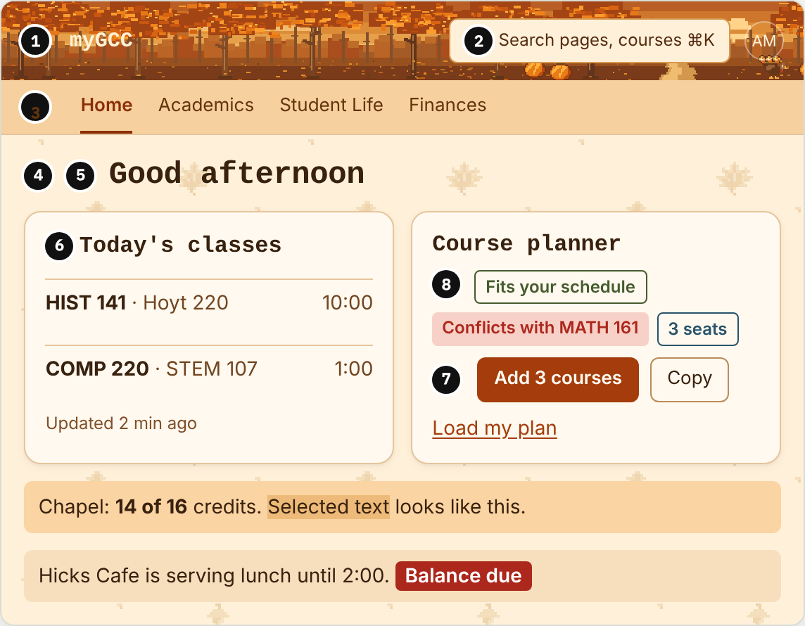
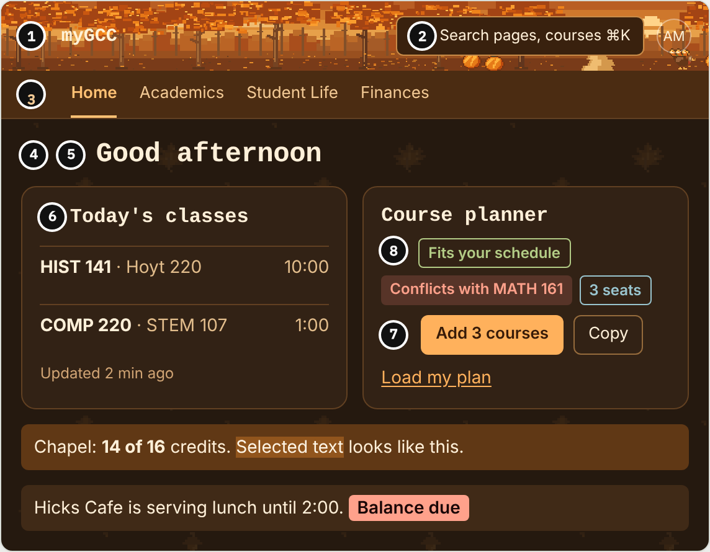

# myGCC Theme Kit

How to design a theme for the aBetterMyGCC extension. It's written for designers, so no coding is needed. You pick colors, draw artwork (if you want), fill in one settings file, and send a folder. The developer adds it to the next update.

> This guide and its files live only in the GitHub repository. They are not part of the extension that students install.

**Contents:** [What you send](#what-you-send) · [Step by step](#step-by-step) · [Where things appear](#where-things-appear) · [Color map](#color-map) · [Artwork specs](#artwork-specs) · [Holiday themes](#holiday-themes) · [Filling in theme.json](#filling-in-themejson) · [Before you send](#before-you-send) · [For the developer](#for-the-developer)

## What you send

A theme is one folder. The folder's name is the theme's **ID**: lowercase letters, numbers and dashes only, such as `spring-bloom`. Inside it go one settings file and any artwork.

```
spring-bloom/
  theme.json              the settings file (start from theme-template.json)
  spring-header.svg       optional header strip
  spring-header.gif       optional animated version of the header
  spring-tile-light.svg   optional page pattern, light mode
  spring-tile-dark.svg    optional page pattern, dark mode
```

- **Both modes are required.** Every theme has a light and a dark version. Students switch between them in the extension's popup.
- **Artwork is optional.** A colors-only theme is a complete theme.
- **Anything you leave out falls back** to the original GCC crimson design, so you can change only the colors you care about.
- **File names** must be lowercase letters, numbers and dashes, ending in `.svg` or `.gif`. No spaces or capitals.

## Step by step

1. **Choose the kind of theme.** *Custom* themes appear in the theme picker and students choose them. *Holiday* themes can't be picked: they switch on by themselves between two dates each year, then step aside. Holiday themes can be more playful.
2. **Build a palette for light and dark.** Start with about six colors per mode: page background, card background, main text, secondary text, accent (links and buttons) and header bar. Everything else can be derived from these. Don't simply invert light to make dark. Dark backgrounds want slightly lighter, less saturated accents, or links glow and become hard to read.
3. **Check contrast as you go.** Students read schedules, balances and deadlines on these colors. Text needs a contrast ratio of at least **4.5 : 1** against what's behind it. Use any contrast checker, such as WebAIM's (webaim.org/resources/contrastchecker), or the contrast plugin in Figma. See [Contrast targets](#contrast-targets).
4. **Draw artwork (optional).** A header strip, a repeating page pattern, or both. Follow the [artwork specs](#artwork-specs) closely, because the extension rejects files that break them.
5. **Fill in theme.json.** Copy `theme-template.json` from this folder, rename it `theme.json`, and replace the colors. See [Filling in theme.json](#filling-in-themejson).
6. **Run through [Before you send](#before-you-send),** then zip the folder and send it to the developer.

## Where things appear

The numbers match the list below. Shown here is the shipping *Autumn pixels* holiday theme, in light and dark mode.





1. Header bar and header art (`--x-bar`, `--x-bar-ink`, `--x-header-art`)
2. Search button (`--x-search-bg`, `--x-search-ink`, `--x-search-border`)
3. Menu bar (`--x-nav-bg`, `--x-nav-ink`, `--x-nav-active`)
4. Page background and page pattern (`--x-bg`, `--x-page-art`)
5. Heading font (`--x-display`)
6. Cards (`--x-surface`, `--x-rule`, `--x-radius`)
7. Links and buttons (`--x-accent`, `--x-accent-ink`)
8. Status colors (`--x-ok`, `--x-bad`, `--x-info`)

## Color map

Each setting has a plain name and a code name starting with `--x-`. The last two columns are the original GCC design, which is what you get for anything you don't set.

| Setting | Code name | Where it shows | GCC light | GCC dark |
|---|---|---|---|---|
| **Backgrounds** | | | | |
| Page background | `--x-bg` | Behind everything, around the cards | `#f5f5f6` | `#161618` |
| Card background | `--x-surface` | Cards, panels, tables, dialogs | `#ffffff` | `#1f1f22` |
| Pale fill | `--x-ground-muted` | Hover backgrounds, hint boxes, table headers | `#efeff1` | `#26262a` |
| **Text and lines** | | | | |
| Main text | `--x-ink` | Body text and headings | `#1e1e1e` | `#ececee` |
| Secondary text | `--x-muted` | Labels, professor names, room numbers | `#504f54` | `#b4b3b8` |
| Caption text | `--x-faint` | Small notes, timestamps, placeholders | `#6d6c71` | `#96959a` |
| Hairline | `--x-rule` | Card borders, table row lines | `#e1e1e4` | `#333337` |
| Strong line | `--x-rule-strong` | Input and secondary button borders | `#cdcdd2` | `#47474c` |
| **Accent** | | | | |
| Accent | `--x-accent` | Links, main buttons, focus rings, checkboxes | `#a60000` | `#ef6b62` |
| Accent hover | `--x-accent-hover` | Links and buttons under the pointer | `#8a0000` | `#ff8a80` |
| Text on accent | `--x-accent-ink` | Words on main buttons | `#ffffff` | `#1a0606` |
| Accent tint | `--x-accent-soft` | Notices, search matches, highlighted rows | `#f7e8e8` | `#2e1c1c` |
| **Header bar** | | | | |
| Header bar | `--x-bar` | The 56 px strip across the top | `#a60000` | `#8a0000` |
| Header text | `--x-bar-ink` | Text and icons on the header | `#ffffff` | `#ffffff` |
| Header line | `--x-bar-line` | Outlines on the header | `rgba(255, 255, 255, 0.4)` | `rgba(255, 255, 255, 0.4)` |
| Header hover | `--x-bar-hover` | Tint under the pointer on the header | `rgba(255, 255, 255, 0.12)` | `rgba(255, 255, 255, 0.12)` |
| **Menu bar** | | | | |
| Menu background | `--x-nav-bg` | The menu row under the header | `var(--x-surface)` | `var(--x-surface)` |
| Menu text | `--x-nav-ink` | Menu items | `var(--x-muted)` | `var(--x-muted)` |
| Current menu item | `--x-nav-active` | The section you are in, and its underline | `var(--x-accent)` | `var(--x-accent)` |
| **Search button** | | | | |
| Search background | `--x-search-bg` | The search button in the header (solid hex only) | `#8a0000` | `#650000` |
| Search hover | `--x-search-hover-bg` | Search button under the pointer (solid hex only) | `#680000` | `#490000` |
| Search text | `--x-search-ink` | Words on the search button | `#ffffff` | `#ffffff` |
| Search outline | `--x-search-border` | Border of the search button | `#d98282` | `#d98282` |
| **Status** | | | | |
| Good | `--x-ok` | "Fits your schedule", met requirements | `#53682b` | `#a9c47f` |
| Problem | `--x-bad` | Conflicts, errors, balances due | `#cc0000` | `#ff8a80` |
| Problem, deep | `--x-bad-deep` | Pressed state of problem buttons | `#990000` | `#c4453b` |
| Text on problem | `--x-bad-ink` | Words on red buttons | `#ffffff` | `#1a0606` |
| Problem tint | `--x-bad-soft` | Background of conflict tags | `rgba(204, 0, 0, 0.16)` | `rgba(255, 138, 128, 0.18)` |
| Problem ring | `--x-bad-ring` | Outline around fields with errors | `rgba(204, 0, 0, 0.22)` | `rgba(255, 138, 128, 0.25)` |
| Info | `--x-info` | Neutral notices and info tags | `#005a8b` | `#7fb8dd` |
| **Selection and depth** | | | | |
| Selected text background | `--x-selection-bg` | When a student highlights text | `var(--x-accent-soft)` | `var(--x-accent-soft)` |
| Selected text | `--x-selection-ink` | Highlighted text color | `var(--x-ink)` | `var(--x-ink)` |
| Dim layer | `--x-scrim` | Behind pop-up dialogs | `rgba(30, 30, 30, 0.45)` | `rgba(0, 0, 0, 0.6)` |
| Card shadow | `--x-shadow` | Under cards | `0 1px 2px rgba(30, 30, 30, 0.05), 0 2p…` | `none` |
| Pop-up shadow | `--x-shadow-pop` | Under dialogs and menus | `0 16px 48px rgba(30, 30, 30, 0.2)` | `0 16px 48px rgba(0, 0, 0, 0.5)` |
| **Type, shape and motion** | | | | |
| Text font | `--x-sans` | Everything except headings | `"Instrument Sans", "Segoe UI", system-…` | `"Instrument Sans", "Segoe UI", system-…` |
| Heading font | `--x-display` | Page titles and card headings | `"Host Grotesk", "Instrument Sans", "Se…` | `"Host Grotesk", "Instrument Sans", "Se…` |
| Card corners | `--x-radius` | Cards and panels | `12px` | `12px` |
| Button corners | `--x-radius-control` | Buttons and inputs | `6px` | `6px` |
| Tag corners | `--x-radius-chip` | Small tags | `4px` | `4px` |
| Animation speed | `--x-speed` | Hover and open transitions, e.g. 160ms | `160ms` | `160ms` |
| Animation easing | `--x-ease` | e.g. ease-out | `ease-out` | `ease-out` |
| **Artwork** | | | | |
| Header art | `--x-header-art` | Header strip, SVG or GIF | `none` | `none` |
| Header art, still | `--x-header-still-art` | SVG shown when animation is off | `none` | `none` |
| Page pattern | `--x-page-art` | Tile repeated behind the page, SVG | `none` | `none` |
| Art rendering | `--x-art-rendering` | auto (smooth) or pixelated (crisp pixel art) | `auto` | `auto` |

### Values you can use

| Kind | What to write |
|---|---|
| Colors | Hex like `#a60000`, or `rgba(204, 0, 0, 0.16)` for see-through tints. **Search button backgrounds must be plain 6-digit hex.** |
| Fonts | A list of font names, first choice first. Only `Instrument Sans`, `Host Grotesk` and fonts already on a student's computer will work. For a new font, ask the developer to add it. |
| Corners | A size such as `12px`. `0px` gives square corners. |
| Shadows | A CSS shadow, or `none`. |
| Reuse | `var(--x-accent)` keeps a setting the same as another one. |

### Contrast targets

- Main, secondary and caption text on page and card backgrounds: **4.5 : 1**
- Links (accent) on cards: **4.5 : 1**
- Button text on accent, header text on the header bar, menu text on the menu bar, search text on the search button: **4.5 : 1**
- Status colors (good, problem, info) on cards: **4.5 : 1**
- Header text must stay readable on top of your header artwork, not only on the plain bar color.

## Artwork specs

There are three places for artwork. Each one can use a different file in light and dark mode.

| | Header strip | Animated header | Page pattern |
|---|---|---|---|
| Format | SVG, or GIF | GIF, looping | SVG only |
| Shown at | 56 px tall, full page width | 56 px tall | 192 × 192 px tile, repeated over the page |
| Draw at | 56 px tall (or 112 px), at least 1024 px wide | Same as header strip | A square artboard (96 or 192 px) |
| Limits | About 140 KB per SVG | Under 128 KB, at most 2048 × 256 px | About 140 KB |
| Setting | `--x-header-art` | `--x-header-art`, plus a still SVG in `--x-header-still-art` | `--x-page-art` |

- **Header strip:** it repeats side to side, so the left and right edges must line up seamlessly. The college logo sits over the left end and the search button and account menu sit over the right, so keep those areas calm.
- **Animated header:** students who turn animation off, or whose computer asks for reduced motion, see the still SVG instead. Keep motion slow and subtle. GIFs work only in the header.
- **Page pattern:** it sits behind every card and table, so keep it quiet: low contrast against the page background, and nothing that reads as text.
- **Pixel art:** set `--x-art-rendering` to `pixelated` so it stays crisp instead of blurring.

### SVG rules

For safety, the extension accepts only simple, flat SVG drawings. A file that breaks these rules is rejected and the theme shows without art.

| Allowed | Rejected |
|---|---|
| Rectangles, circles, ellipses, lines, polygons, paths | Live text (convert it to outlines) |
| Groups | Gradients, patterns, masks, clipping paths, filters, blur |
| Solid fills and strokes written on each shape | Embedded or linked images (no PNG or JPG inside) |
| A title or description | `<style>` blocks, `<defs>`, `<use>`, comments, a DOCTYPE line |
| | Anything that links to another file or website |

**Exporting from Figma**

- Select the frame, then Object › Flatten (⌘E) so masks and boolean shapes become plain paths. This also outlines text.
- Turn off *Clip content* on the frame, or the export adds a clipping path.
- Export as SVG with *Include "id" attribute* off and *Outline text* on.

**Exporting from Illustrator**

- Type › Create Outlines, then Object › Expand Appearance.
- Release any clipping masks and replace gradients with flat colors.
- File › Export › Export As › SVG. Styling: *Presentation Attributes*. Turn off *Preserve* for images.
- For pixel art, set the artboard to whole pixels and draw with squares.

**Quick self-check:** open the exported SVG in a text editor and search for `<text`, `<defs`, `<style`, `Gradient`, `clipPath`, `mask`, `<image`, `href` and `<!--`. If any of them appear, fix the drawing and export again.

## Holiday themes

- A holiday theme has a start and an end date written month-day: `11-15` is November 15. Both days are included, and dates follow Eastern time.
- It can run across New Year: `12-18` to `01-02` works.
- While it's active it temporarily replaces the student's chosen theme. Students can switch holiday themes off in the popup.
- If two holiday themes overlap, the one with the higher **priority** wins (from −100 to 100).

Already scheduled:

| Theme | Dates | Priority |
|---|---|---|
| Autumn pixels | 11-15 to 11-26 | 10 |

Check with the developer which dates are free.

## Filling in theme.json

Copy `theme-template.json` from this folder and rename it `theme.json`. It holds every setting with the GCC values, so you only replace what you want to change. Edit it in a plain-text editor such as VS Code, Notepad, or TextEdit after choosing Format › Make Plain Text.

The top of the file describes the theme:

```json
{
  "schemaVersion": 1,
  "id": "spring-bloom",
  "name": "Spring bloom",
  "type": "custom",
  "description": "Soft greens and cherry blossoms.",
  "light": { ... },
  "dark": { ... }
}
```

| Line | What to put |
|---|---|
| `schemaVersion` | Leave it as `1`. |
| `id` | The folder name, exactly. Up to 48 lowercase letters, numbers and dashes. |
| `name` | What students see in the picker. Up to 80 characters. |
| `type` | `"custom"` or `"holiday"`. |
| `description` | One sentence, up to 300 characters. |
| `light`, `dark` | The settings for each mode. Delete any line you don't change, or leave it as is. |

For a **holiday** theme, set `"type": "holiday"` and add this after the `dark` section (mind the comma after the closing `}` of `dark`):

```json
  "holiday": { "start": "12-18", "end": "01-02", "priority": 0 }
```

**Artwork** goes in as `asset:` followed by the file name. Use `none` for no art:

```json
"--x-header-art": "asset:spring-header.gif",
"--x-header-still-art": "asset:spring-header.svg",
"--x-page-art": "asset:spring-tile-light.svg",
"--x-art-rendering": "auto",
```

**Formatting rules** (the most common reasons a file won't load):

- Every name and value is in straight double quotes: `"#a60000"`, not `“#a60000”`. Word processors and some Mac editors swap in curly quotes, so turn off smart quotes.
- Every line in a section ends with a comma except the last one.
- Only use setting names from the [color map](#color-map). A misspelled name stops the whole theme loading.

## Before you send

- [ ] The folder name and `id` match, and both are lowercase with dashes.
- [ ] `theme.json` has a `light` and a `dark` section.
- [ ] Every text color passes 4.5 : 1 against its background, in both modes.
- [ ] Search button backgrounds are 6-digit hex colors.
- [ ] Every `asset:` file name matches a file in the folder exactly.
- [ ] SVGs pass the quick self-check above, and page patterns are square.
- [ ] Any GIF is under 128 KB, is only used as header art, and has a still SVG twin.
- [ ] Holiday themes have a start date, end date and priority.

Zip the folder and send it to the developer.

## For the developer

When a designer sends a folder:

1. **Add it.** Copy the folder to `themes/<id>/` and add the ID to the `themes` list in `themes/index.json`. The extension can't list folders, so a theme missing from that list never loads. (If you build from the workspace with `node themes/build.cjs`, add it to the workspace `themes/` folder instead.)
2. **Try it.** Reload the unpacked extension at `chrome://extensions`. Open the demo from the toolbar popup and pick the theme in its preview menu; the demo shows holiday themes whatever the date. A rejected pack logs `[themes] skipped …` with the reason in the console, and the extension falls back to GCC.
3. **Ship it.** Bump `version` in `manifest.json`, mention the theme in What's New and the README, and zip the extension **without the `docs/` folder**:

   ```
   zip -r abettermygcc.zip . -x 'docs/*' '.git/*'
   ```
